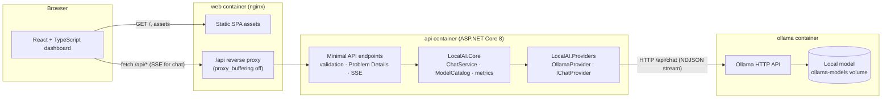

# Local AI Infrastructure — Phase 1

A self-hosted platform for running and using a local large language model behind a properly engineered API.

It has three parts:

- **ASP.NET Core 8 API:** validation, streaming, health checks, and error normalization.
- **React + TypeScript dashboard:** chat, model management, and system status.
- **Ollama:** inference, running entirely on your machine.

No cloud AI service, API key, or paid dependency is required.

```
Browser ──► React dashboard (nginx) ──/api──► ASP.NET Core API ──► IChatProvider ──► Ollama ──► local model
```

## Contents

1. [Overview](#overview)
2. [Architecture](#architecture)
3. [Technology stack](#technology-stack)
4. [Prerequisites](#prerequisites)
5. [Repository structure](#repository-structure)
6. [Local development](#local-development)
7. [Docker deployment](#docker-deployment)
8. [Downloading a model](#downloading-a-model)
9. [Configuration reference](#configuration-reference)
10. [API reference](#api-reference)
11. [Running tests](#running-tests)
12. [Troubleshooting](#troubleshooting)
13. [Known limitations](#known-limitations)
14. [Security notes](#security-notes)
15. [Roadmap](#roadmap)

## Overview

What Phase 1 delivers:

- **Chat with true end-to-end streaming.** Ollama sends NDJSON, the API turns it into Server-Sent Events, nginx passes it through unbuffered, and React renders it incrementally. You can stop, retry, start a new conversation, and copy responses. Markdown is rendered safely.
- **Model management.** Lists the models actually installed in Ollama (size, tag, family, parameters, quantization). Lets you select one, refresh the list, and see an explicit empty state with download instructions. Ollama "cloud" models are detected and blocked by default.
- **System status that separates four layers:**
  - API health
  - Ollama connectivity
  - Model availability
  - Proven inference capability (the last real successful generation)

  Request counters are real in-memory values; no metric is fabricated.
- **Reliability.** Bounded timeouts. Caller cancellation is distinguished from timeouts. Malformed upstream data is detected. Errors are normalized to RFC 7807 Problem Details, with a concurrency limit on generations.
- **Containerized deployment** with health checks, persistent model storage, a non-root API, and localhost-only port bindings. GPU support is optional.

## Architecture



The browser never talks to Ollama. All inference goes through the API, which owns validation, model resolution, streaming, cancellation, timeouts, and error mapping. See [docs/architecture.md](docs/architecture.md) for the request lifecycle and design decisions.

## Technology stack

| Layer | Technology |
|---|---|
| Backend | .NET 8 (LTS), ASP.NET Core minimal APIs, C# 12 with nullable reference types, `IHttpClientFactory`, options validation, built-in rate limiting, Swashbuckle 6.9 (Swagger) |
| Tests (backend) | xUnit 2.9, `Microsoft.AspNetCore.Mvc.Testing` 8.0 |
| Frontend | React 19.3, TypeScript 6.0 (strict), Vite 8.3, `react-markdown` 10 + `remark-gfm` |
| Tests (frontend) | Vitest 5, Testing Library, jsdom |
| Inference | Ollama 0.40.4 (native HTTP API) |
| Infrastructure | Docker, Docker Compose, nginx (unprivileged image) |

All NuGet versions are pinned centrally in [Directory.Packages.props](Directory.Packages.props). npm versions are exact in [package.json](src/LocalAI.Web/package.json) and locked by `package-lock.json`.

## Prerequisites

| For | You need |
|---|---|
| Running with Docker (recommended) | Docker Engine / Docker Desktop with Compose v2, ~3 GB of disk for images plus the model size, and 8 GB RAM for small models |
| Backend development | .NET 8 SDK (or a newer SDK plus the **.NET 8 runtime**; see [docs/development.md](docs/development.md)) |
| Frontend development | Node.js ≥ 20.19 (22 LTS recommended) and npm |
| Running without Docker | Ollama installed natively ([ollama.com/download](https://ollama.com/download)) |

A GPU is **not** required. Small models run on CPU.

## Repository structure

```
.
├── docker-compose.yml               # web + api + ollama
├── .env.example                     # every configurable value, with safe defaults
├── Directory.Build.props            # net8.0, nullable, warnings-as-errors, analyzers
├── Directory.Packages.props         # pinned NuGet versions
├── LocalAI.sln
├── src/
│   ├── LocalAI.Core/                # provider-agnostic domain
│   │   ├── Interfaces/IChatProvider.cs
│   │   ├── Models/                  # chat + model records
│   │   ├── Exceptions/InferenceException.cs
│   │   └── Services/                # ChatService, ModelCatalog, ChatRequestValidator,
│   │                                # ProviderStatusService, InferenceMetrics, ChatOptions
│   ├── LocalAI.Providers/
│   │   └── Ollama/                  # OllamaClient, OllamaProvider, OllamaOptions,
│   │                                # OllamaModels (wire DTOs), NdjsonLineReader
│   ├── LocalAI.Api/
│   │   ├── Endpoints/               # Chat + status endpoints
│   │   ├── Contracts/               # request/response/SSE payload records
│   │   ├── Streaming/               # ChatStreamResult (SSE writer)
│   │   ├── Middleware/              # Problem Details mapping, request-size guard
│   │   ├── Configuration/           # ApiOptions + validation
│   │   └── Program.cs
│   └── LocalAI.Web/                 # React + Vite dashboard
│       └── src/{api,components,features/{chat,models,system},hooks,layouts,pages,types,utils,styles,test}
├── tests/
│   ├── LocalAI.Core.Tests/          # validation, model catalog, chat service, cancellation
│   ├── LocalAI.Providers.Tests/     # NDJSON framing, malformed data, timeouts, error mapping
│   ├── LocalAI.Api.Tests/           # HTTP + SSE integration tests with a fake provider
│   └── Shared/FakeChatProvider.cs
├── infrastructure/
│   ├── docker/                      # api.Dockerfile, web.Dockerfile, nginx.conf
│   └── compose/                     # optional GPU and Ollama-port overlays
└── docs/                            # architecture.md, api.md, development.md
```

## Local development

The short version is below. [docs/development.md](docs/development.md) explains how to run each piece independently.

```bash
# 1. Ollama (native install), plus a small model
ollama pull qwen2.5:0.5b

# 2. API on http://localhost:5080 (Swagger at /swagger in Development)
dotnet run --project src/LocalAI.Api --launch-profile http

# 3. Dashboard on http://localhost:5173 (Vite proxies /api to :5080)
cd src/LocalAI.Web && npm ci && npm run dev
```

## Docker deployment

```bash
cp .env.example .env            # optional; all values have defaults
docker compose up -d --build
docker compose ps               # wait until all three services are healthy
```

Open **http://localhost:8080**. If port 8080 is taken, set `WEB_PORT=8090` in `.env` or the environment.

Startup order is `ollama` (healthy) → `api` (healthy) → `web`. Compose ordering only means the Ollama server is up. It does **not** mean a model is installed or loaded. The API reports that separately, and the dashboard shows "No model installed" until you pull one.

| Service | Exposed on host | Notes |
|---|---|---|
| `web` | `127.0.0.1:${WEB_PORT:-8080}` | nginx: SPA + `/api` proxy (SSE-safe) |
| `api` | `127.0.0.1:${API_PORT:-5080}` | For curl/Swagger. Non-root, read-only filesystem |
| `ollama` | not published | Reachable only from `api` on the `backend` network |

Models live in the named volume `ollama-models` and survive `docker compose down`. Use `docker compose down -v` to delete them.

**GPU (optional, NVIDIA on Linux/WSL2 with the NVIDIA Container Toolkit):**

```bash
docker compose -f docker-compose.yml -f infrastructure/compose/docker-compose.gpu.yml up -d
```

Docker Desktop on macOS cannot pass the Apple GPU into containers, so the containerized Ollama runs on CPU there. For Metal acceleration on a Mac, run Ollama natively and the API outside Docker (see [docs/development.md](docs/development.md)).

## Downloading a model

The application never downloads models by itself and exposes no download endpoint. An administrator pulls models with the Ollama CLI:

```bash
docker compose exec ollama ollama pull qwen2.5:0.5b
docker compose exec ollama ollama list          # verify
curl -s http://127.0.0.1:5080/api/models        # the API now lists it
curl -s http://127.0.0.1:5080/api/health/ready  # "ready" (HTTP 200)
```

Then refresh the model list in the dashboard (or wait up to 30 s) and start chatting.

| Model | Download | Notes |
|---|---|---|
| `qwen2.5:0.5b` | ~400 MB | Default. Runs comfortably on CPU with 8 GB RAM; quality is basic |
| `llama3.2:1b` | ~1.3 GB | Better quality, still CPU-friendly |
| `qwen2.5:3b` / `llama3.2:3b` | ~2 GB | Needs ~6–8 GB free RAM; noticeably slower on CPU |

`Chat__DefaultModel` (`OLLAMA_DEFAULT_MODEL` in `.env`) only sets the *preferred* model. It is used only if actually installed; otherwise the first installed local model is selected.

## Configuration reference

Configuration uses standard ASP.NET Core sources: `appsettings.json`, then `appsettings.{Environment}.json`, then environment variables (`Section__Key`). Invalid values **stop the API at startup** with a message naming the setting.

| Setting (env var) | Default | Purpose |
|---|---|---|
| `Ollama__BaseUrl` | `http://localhost:11434` (compose: `http://ollama:11434`) | Ollama HTTP API; must be absolute http(s) |
| `Ollama__ConnectTimeout` | `00:00:05` | TCP connect timeout |
| `Ollama__MetadataTimeout` | `00:00:10` | Version and model-list calls |
| `Ollama__InferenceTimeout` | `00:05:00` | Whole generation, including model load |
| `Ollama__KeepAlive` | *(server default)* | Ollama `keep_alive`, e.g. `5m`, `0` |
| `Chat__DefaultModel` | `qwen2.5:0.5b` | Preferred model (never auto-downloaded) |
| `Chat__MaxMessageLength` | `8000` | Max characters per message (prompt length) |
| `Chat__MaxConversationLength` | `32000` | Max characters across all messages in a request |
| `Chat__MaxMessages` | `50` | Max messages per request |
| `Chat__DefaultMaxTokens` | `1024` | Generation length when the client sends none (`num_predict`) |
| `Chat__MaxTokensLimit` | `4096` | Upper bound for client-requested `maxTokens` |
| `Chat__AllowRemoteModels` | `false` | Allow Ollama "cloud" models that run on a third-party host |
| `Chat__ModelListCacheDuration` | `00:00:05` | Model list cache |
| `Api__CorsAllowedOrigins` | `[]` | Explicit origins only; wildcards rejected. Not needed with the proxy |
| `Api__MaxRequestBodyBytes` | `262144` | Request body limit (HTTP 413 above it) |
| `Api__MaxConcurrentGenerations` | `2` | Concurrent chats; excess gets HTTP 429 |
| `Api__EnableSwagger` | `false` (`true` in Development) | Swagger UI at `/swagger` |
| `Logging__LogLevel__Default` | `Information` | Log level |
| `ASPNETCORE_ENVIRONMENT` | `Production` (compose) | `Development` enables Swagger and debug logging |
| `VITE_API_BASE_URL` (build time) | empty | Empty means same-origin `/api`. Set only for a cross-origin API, and never put secrets in it |

Compose maps the friendlier names in [.env.example](.env.example) (for example `OLLAMA_DEFAULT_MODEL`, `WEB_PORT`) onto these settings.

## API reference

| Method | Path | Purpose |
|---|---|---|
| GET | `/api/health` | Liveness: the API process is up (no dependency checks) |
| GET | `/api/health/ready` | Readiness: `ready` (200) / `degraded` (503, no usable model) / `unavailable` (503) |
| GET | `/api/models[?refresh=true]` | Installed models with availability flags |
| GET | `/api/models/status` | Provider connectivity, model availability, last successful inference |
| POST | `/api/chat/stream` | Streams a reply as SSE: `start`, `delta`*, then `done` or `error` |
| POST | `/api/chat` | Same request, buffered JSON response |
| GET | `/api/system/overview` | API, provider, model, and inference statistics snapshot |

Full contracts, the SSE event schema, and error codes are in [docs/api.md](docs/api.md).

```bash
curl -N -X POST http://127.0.0.1:5080/api/chat/stream \
  -H 'Content-Type: application/json' \
  -d '{"model":"qwen2.5:0.5b","messages":[{"role":"user","content":"Hello!"}]}'
```

## Running tests

| Suite | Command | Count |
|---|---|---|
| Backend, all (authoritative, real .NET 8 SDK in Docker) | `docker build -f infrastructure/docker/api.Dockerfile --target test .` | 100 |
| Backend, local | `dotnet test LocalAI.sln` (needs the .NET 8 runtime; see below) | 100 |
| Frontend | `cd src/LocalAI.Web && npm test` | 21 |
| Frontend lint / types | `npm run lint && npm run typecheck` | — |
| Frontend, in Docker | `docker build -f infrastructure/docker/web.Dockerfile --target test .` | 21 |

Tests use a fake provider or a stubbed HTTP handler. They never need Ollama, a GPU, or a downloaded model.

> **Machines with only a newer .NET SDK/runtime.** Test projects use `RollForward=Major`, so `Core` and `Providers` tests run on a newer runtime. The `Api` integration tests do **not**: the .NET 8 `TestHost` package is incompatible with the .NET 10 runtime's System.Text.Json (`ResponseBodyPipeWriter does not implement UnflushedBytes`). Install the .NET 8 runtime or use the Docker test stage above.

## Troubleshooting

| Symptom | Cause / fix |
|---|---|
| Dashboard says **"Ollama is not reachable"** | `docker compose ps ollama`; start it with `docker compose up -d ollama`. On a native setup, check `Ollama__BaseUrl` and `curl $BASE/api/version` |
| **"No model installed"** | `docker compose exec ollama ollama pull qwen2.5:0.5b`, then refresh models |
| `/api/health/ready` returns 503 `degraded` | Ollama is up but no usable (local) model is installed |
| First reply is slow | The model loads into memory on first use (the `load` time is shown under the reply). `OLLAMA_KEEP_ALIVE` controls how long it stays loaded |
| `model_load_failed` | Not enough RAM for that model; use a smaller one or free memory / raise Docker Desktop's memory limit |
| `provider_timeout` | Generation exceeded `Ollama__InferenceTimeout`; raise it or use a smaller model / lower `maxTokens` |
| HTTP 429 `too_many_generations` | `Api__MaxConcurrentGenerations` reached; wait or raise the limit |
| Cloud model listed as "Remote · disabled" | Intentional. Set `Chat__AllowRemoteModels=true` only if you accept third-party inference |
| `ports are not available ... 8080` | Another process uses the port; set `WEB_PORT` (or `API_PORT`) |
| API exits at startup with `OptionsValidationException` | A configuration value is invalid; the message names the setting |
| Streaming arrives all at once behind another proxy | That proxy buffers; disable response buffering for `/api/chat/stream` (the API already sends `X-Accel-Buffering: no`) |

Logs: `docker compose logs -f api` (prompts and responses are never logged; only model, sizes, durations, and error codes).

## Known limitations

- Conversations live only in browser memory. Reloading the tab clears them (persistence is Phase 2).
- No authentication. The platform is meant for a single user on localhost (see [Security notes](#security-notes)).
- Request counters are in-memory and reset when the API restarts. Only the single API instance is counted.
- "Thinking" output from reasoning models (Ollama's `message.thinking` field) is not displayed; only answer content is streamed.
- On macOS, containerized Ollama is CPU-only.
- `num_predict` (`maxTokens`) is passed to the model, but there is no context-window management. Very long conversations are bounded only by the character limits.
- Model downloads are CLI-only by design (no admin endpoint in Phase 1).

## Security notes

Implemented defaults:

- Ports are bound to `127.0.0.1` only. Ollama is unpublished and isolated from `web` by network segmentation.
- The API runs as a non-root user with a read-only root filesystem, `no-new-privileges`, and all capabilities dropped. The same hardening applies to nginx.
- There are no administrative, shell, file, or proxy endpoints. The only upstream calls go to the configured Ollama base URL with fixed paths.
- All input is validated. Model identifiers are pattern-checked. Body size, message count, lengths, `maxTokens`, and concurrency are all bounded, and every upstream call has a timeout.
- Errors return Problem Details with safe messages. Upstream errors and stack traces go only to the server log.
- CORS is off by default; explicit origins only, and wildcards are rejected.
- Model output is untrusted. Raw HTML is not rendered, `javascript:` links are stripped, and **images in model output are not loaded**, which prevents data exfiltration through crafted image URLs. nginx sends a strict Content Security Policy.
- Prompts and responses are not logged.

**Exposing it beyond localhost is not safe as-is.** Before binding to `0.0.0.0` or another network, add all of the following:

- Authentication, for example a reverse proxy with OIDC or basic auth.
- TLS termination.
- Firewall rules restricting source addresses.
- Request rate limiting per client.

Never publish Ollama's port: it has no authentication. Running in Docker does not by itself make this production-secure.

## Roadmap

- **Phase 2 — persistence and operability:** conversation storage (SQLite/PostgreSQL), authentication for single and small-team use, OpenTelemetry metrics and structured logs, Prometheus/Grafana dashboards, and model pull/delete through an authenticated admin API with an audit log.
- **Phase 3 — retrieval and multiple providers:** a RAG pipeline with a vector store (e.g. Qdrant/pgvector), document ingestion, and additional `IChatProvider` implementations (llama.cpp server, vLLM, OpenAI-compatible endpoints) with per-model routing.
- **Phase 4 — scale and performance:** GPU scheduling and multiple inference nodes, Kubernetes deployment, request queuing and autoscaling, load and latency benchmarking, and evaluation harnesses.
