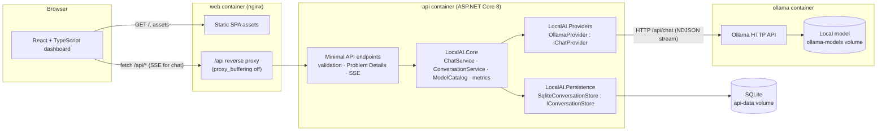

# Local AI Infrastructure

[](https://github.com/burmeseitman/local-ai-infra/actions/workflows/ci.yml)

A self-hosted platform for running and using a local large language model behind a properly engineered API.

It has three parts:

- **ASP.NET Core 8 API:** validation, streaming, health checks, and error normalization.
- **React + TypeScript dashboard:** chat, model management, and system status.
- **Ollama:** inference, running entirely on your machine.

No cloud AI service, API key, or paid dependency is required.

**Status:** Phase 1 (platform) is complete. Phase 2 so far: server-side **conversation history** and **local accounts**. Phase 3 has started with **chat with your documents** (local RAG with citations) and a **native-Ollama mode** that uses the Apple GPU (see [Roadmap](#roadmap)).

```
Browser ──► React dashboard (nginx) ──/api──► ASP.NET Core API ──► IChatProvider ──► Ollama ──► local model
```

## Contents

1. [Overview](#overview)
2. [Architecture](#architecture)
3. [Technology stack](#technology-stack)
4. [Prerequisites](#prerequisites)
5. [Repository structure](#repository-structure)
6. [Local development](#local-development)
7. [Docker deployment](#docker-deployment)
8. [Downloading a model](#downloading-a-model)
9. [Configuration reference](#configuration-reference)
10. [API reference](#api-reference)
11. [Running tests](#running-tests)
12. [Troubleshooting](#troubleshooting)
13. [Known limitations](#known-limitations)
14. [Security notes](#security-notes)
15. [Roadmap](#roadmap)

## Overview

What Phase 1 delivers:

- **Chat with your documents (Phase 3).**
  - **Your library:** upload PDF, TXT, or Markdown files (up to 10 MB) on the **Documents** page. Each user's documents are private.
  - **Indexing:** text is extracted on the server, split into overlapping chunks, and embedded in the background by a local embedding model (`nomic-embed-text` via Ollama). Status shows as *Indexing… → Ready / Failed*.
  - **Asking:** turn on **Use my documents** in Chat. The API finds the most relevant passages and has the model answer with inline citations `[1]`, then shows the sources (title, PDF page, snippet) under the reply. Sources are saved with the conversation.
  - **When nothing matches:** the model says so and answers from general knowledge.
  - **Privacy:** nothing leaves the machine.
- **Local accounts (Phase 2).**
  - **First run:** the dashboard asks you to create the administrator. There is no default password and no public sign-up; the administrator creates the other users.
  - **Isolation:** each user sees only their own conversations, and another user's conversation reads as "not found".
  - **Sessions:** HttpOnly, `SameSite=Strict` cookies that expire after 7 days without use.
  - **Passwords:** hashed with PBKDF2 (ASP.NET Core Identity's hasher). Changing a password or role signs out that user's other sessions.
  - **Throttling:** repeated failed sign-ins lock that username for 5 minutes.
- **Saved conversations (Phase 2).** History lives in SQLite on the server. The browser sends only the new message, and the API loads the context, stores both sides of the turn, and keeps the reply whether it completes, is stopped, or fails. You can list, open (`#/chat/<id>`), rename, and delete conversations, and history survives reloads and restarts.
- **Chat with true end-to-end streaming.** Ollama sends NDJSON, the API turns it into Server-Sent Events, nginx passes it through unbuffered, and React renders it incrementally. You can stop, retry, start a new conversation, and copy responses. Markdown is rendered safely.
- **Model management.** Lists the models actually installed in Ollama (size, tag, family, parameters, quantization). Lets you select one, refresh the list, and see an explicit empty state with download instructions. Ollama "cloud" models are detected and blocked by default.
- **System status that separates four layers:**
  - API health
  - Ollama connectivity
  - Model availability
  - Proven inference capability (the last real successful generation)

  Request counters are real in-memory values; no metric is fabricated.
- **Reliability.** Bounded timeouts. Caller cancellation is distinguished from timeouts. Malformed upstream data is detected. Errors are normalized to RFC 7807 Problem Details, with a concurrency limit on generations.
- **Containerized deployment** with health checks, persistent model storage, a non-root API, and localhost-only port bindings. GPU support is optional.

## Architecture



The browser never talks to Ollama. All inference goes through the API, which owns validation, model resolution, streaming, cancellation, timeouts, and error mapping. See [docs/architecture.md](docs/architecture.md) for the request lifecycle and design decisions.

## Technology stack

| Layer | Technology |
|---|---|
| Auth | ASP.NET Core cookie authentication + authorization (fallback policy: authenticated), `PasswordHasher` from `Microsoft.Extensions.Identity.Core` 8.0, Data Protection keys persisted to the data volume |
| Documents (RAG) | PdfPig 0.1.16 (PDF text, Apache-2.0), Ollama `/api/embed` with `nomic-embed-text`, exact cosine search with `System.Numerics.Tensors` (SIMD) over vectors stored in SQLite |
| Persistence | SQLite via EF Core 8.0 (`Microsoft.EntityFrameworkCore.Sqlite`), code-first migrations, WAL mode |
| Backend | .NET 8 (LTS), ASP.NET Core minimal APIs, C# 12 with nullable reference types, `IHttpClientFactory`, options validation, built-in rate limiting, Swashbuckle 6.9 (Swagger) |
| Tests (backend) | xUnit 2.9, `Microsoft.AspNetCore.Mvc.Testing` 8.0 |
| Frontend | React 19.3, TypeScript 6.0 (strict), Vite 8.3, `react-markdown` 10 + `remark-gfm` |
| Tests (frontend) | Vitest 5, Testing Library, jsdom |
| Inference | Ollama 0.40.4 (native HTTP API) |
| Infrastructure | Docker, Docker Compose, nginx (unprivileged image) |

All NuGet versions are pinned centrally in [Directory.Packages.props](Directory.Packages.props). npm versions are exact in [package.json](src/LocalAI.Web/package.json) and locked by `package-lock.json`.

## Prerequisites

| For | You need |
|---|---|
| Running with Docker (recommended) | Docker Engine / Docker Desktop with Compose v2, ~3 GB of disk for images plus the model size, and 8 GB RAM for small models |
| Backend development | .NET 8 SDK (or a newer SDK plus the **.NET 8 runtime**; see [docs/development.md](docs/development.md)) |
| Frontend development | Node.js ≥ 20.19 (22 LTS recommended) and npm |
| Running without Docker | Ollama installed natively ([ollama.com/download](https://ollama.com/download)) |

A GPU is **not** required. Small models run on CPU.

## Repository structure

```
.
├── docker-compose.yml               # web + api + ollama
├── .env.example                     # every configurable value, with safe defaults
├── Directory.Build.props            # net8.0, nullable, warnings-as-errors, analyzers
├── Directory.Packages.props         # pinned NuGet versions
├── dotnet-tools.json                # pinned dotnet-ef 8.0.11 (migrations)
├── LocalAI.sln
├── src/
│   ├── LocalAI.Core/                # provider-agnostic domain
│   │   ├── Interfaces/IChatProvider.cs
│   │   ├── Models/                  # chat + model records
│   │   ├── Exceptions/InferenceException.cs
│   │   └── Services/                # DocumentService, DocumentIngestionWorker, DocumentRetriever,
│   │                                # TextChunker, AccountService, ChatService, ConversationService, HistoryWindow,
│   │                                # ModelCatalog, ChatRequestValidator, ProviderStatusService,
│   │                                # InferenceMetrics, ConversationLocks, ChatOptions
│   ├── LocalAI.Providers/
│   │   ├── Documents/               # PDF (PdfPig) and plain-text extractors
│   │   └── Ollama/                  # OllamaClient (chat + /api/embed), OllamaProvider, OllamaOptions,
│   │                                # OllamaModels (wire DTOs), NdjsonLineReader
│   ├── LocalAI.Persistence/         # EF Core DbContext, SqliteConversationStore, Migrations/
│   ├── LocalAI.Api/
│   │   ├── Endpoints/               # Chat + status endpoints
│   │   ├── Contracts/               # request/response/SSE payload records
│   │   ├── Streaming/               # ChatStreamResult (SSE writer)
│   │   ├── Middleware/              # Problem Details mapping, request-size guard
│   │   ├── Configuration/           # ApiOptions + validation
│   │   └── Program.cs
│   └── LocalAI.Web/                 # React + Vite dashboard
│       └── src/{api,components,features/{chat,conversations,models,system},hooks,layouts,pages,types,utils,styles,test}
├── tests/
│   ├── LocalAI.Core.Tests/          # validation, model catalog, chat service, cancellation
│   ├── LocalAI.Providers.Tests/     # NDJSON framing, malformed data, timeouts, error mapping
│   ├── LocalAI.Persistence.Tests/   # real SQLite + migrations: ordering, cascade, round-trips
│   ├── LocalAI.Api.Tests/           # HTTP + SSE integration tests with a fake provider
│   └── Shared/                      # FakeChatProvider, InMemoryConversationStore
├── infrastructure/
│   ├── docker/                      # api.Dockerfile, web.Dockerfile, nginx.conf
│   └── compose/                     # optional overlays: NVIDIA GPU, native Ollama (Apple GPU), Ollama port
└── docs/                            # architecture.md, api.md, development.md
```

## Local development

The short version is below. [docs/development.md](docs/development.md) explains how to run each piece independently.

```bash
# 1. Ollama (native install), plus a small model
ollama pull qwen2.5:0.5b

# 2. API on http://localhost:5080 (Swagger at /swagger in Development)
dotnet run --project src/LocalAI.Api --launch-profile http

# 3. Dashboard on http://localhost:5173 (Vite proxies /api to :5080)
cd src/LocalAI.Web && npm ci && npm run dev
```

## Docker deployment

```bash
cp .env.example .env            # optional; all values have defaults
docker compose up -d --build
docker compose ps               # wait until all three services are healthy
```

Open **http://localhost:8080** and create the administrator account on first visit. If port 8080 is taken, set `WEB_PORT=8090` in `.env` or the environment.

Startup order is `ollama` (healthy) → `api` (healthy) → `web`. Compose ordering only means the Ollama server is up. It does **not** mean a model is installed or loaded. The API reports that separately, and the dashboard shows "No model installed" until you pull one.

| Service | Exposed on host | Notes |
|---|---|---|
| `web` | `127.0.0.1:${WEB_PORT:-8080}` | nginx: SPA + `/api` proxy (SSE-safe) |
| `api` | `127.0.0.1:${API_PORT:-5080}` | For curl/Swagger. Non-root, read-only filesystem |
| `ollama` | not published | Reachable only from `api` on the `backend` network |

Models live in the named volume `ollama-models`, and conversations in `api-data` (SQLite at `/app/data/localai.db`). Both survive `docker compose down`. **`docker compose down -v` deletes them.** The API applies database migrations automatically at startup.

Back up conversations. Stop the API briefly so the SQLite file and its WAL are consistent:

```bash
docker compose stop api
docker run --rm -v local-ai-infrastructure_api-data:/data:ro alpine tar czf - -C /data . > localai-data-backup.tgz
docker compose start api
```

**GPU (optional, NVIDIA on Linux/WSL2 with the NVIDIA Container Toolkit):**

```bash
docker compose -f docker-compose.yml -f infrastructure/compose/docker-compose.gpu.yml up -d
```

Docker Desktop on macOS cannot pass the Apple GPU into containers, so the containerized Ollama runs on CPU there. For Metal acceleration on a Mac, run Ollama natively and the API outside Docker (see [docs/development.md](docs/development.md)).

## Downloading a model

The application never downloads models by itself and exposes no download endpoint. An administrator pulls models with the Ollama CLI:

```bash
docker compose exec ollama ollama pull qwen2.5:0.5b
docker compose exec ollama ollama list          # verify
curl -s http://127.0.0.1:5080/api/models        # the API now lists it
curl -s http://127.0.0.1:5080/api/health/ready  # "ready" (HTTP 200)
```

Then refresh the model list in the dashboard (or wait up to 30 s) and start chatting. For **document chat**, also install the embedding model (~270 MB) once:

```bash
docker compose exec ollama ollama pull nomic-embed-text
```

Measured on an Apple M3 Pro with 18 GB of RAM, same prompt:

| Model | Where | Download | Speed | Quality |
|---|---|---|---|---|
| `qwen2.5:0.5b` | Docker (CPU) | ~400 MB | ~54 tok/s | Fast, but unreliable answers |
| `qwen2.5:3b` | Docker (CPU) | ~1.9 GB | ~7 tok/s | **Default.** Sensible answers; the smallest model that handles document Q&A well |
| `qwen2.5:7b` | **Native Ollama (Apple GPU)** | ~4.7 GB | **~28 tok/s** | Best of the three, and the fastest. Recommended on a Mac |

### Native Ollama (Apple GPU)

Docker Desktop on macOS can't give containers the GPU, so the bundled Ollama runs on CPU. For the best experience on a Mac, run Ollama natively and let the containers use it:

```bash
brew install ollama          # or the installer from ollama.com; then start it
ollama pull qwen2.5:7b
ollama pull nomic-embed-text
docker compose -f docker-compose.yml -f infrastructure/compose/docker-compose.native-ollama.yml up -d web
```

`up -d web` starts only `web` and `api`; the bundled `ollama` container isn't needed. The API reaches the host through `host.docker.internal`, which works with Ollama's default `127.0.0.1` binding on Docker Desktop. Models then live in `~/.ollama` on the host. On Linux, see the comments in that file before changing Ollama's listen address.

`Chat__DefaultModel` (`OLLAMA_DEFAULT_MODEL` in `.env`) only sets the *preferred* model. It is used only if actually installed; otherwise the first installed local model is selected.

## Configuration reference

Configuration uses standard ASP.NET Core sources: `appsettings.json`, then `appsettings.{Environment}.json`, then environment variables (`Section__Key`). Invalid values **stop the API at startup** with a message naming the setting.

| Setting (env var) | Default | Purpose |
|---|---|---|
| `Ollama__BaseUrl` | `http://localhost:11434` (compose: `http://ollama:11434`) | Ollama HTTP API; must be absolute http(s) |
| `Ollama__ConnectTimeout` | `00:00:05` | TCP connect timeout |
| `Ollama__MetadataTimeout` | `00:00:10` | Version and model-list calls |
| `Ollama__InferenceTimeout` | `00:05:00` | Whole generation, including model load |
| `Ollama__KeepAlive` | *(server default)* | Ollama `keep_alive`, e.g. `5m`, `0` |
| `Chat__DefaultModel` | `qwen2.5:0.5b` | Preferred model (never auto-downloaded) |
| `Chat__MaxMessageLength` | `8000` | Max characters per message (prompt length) |
| `Chat__MaxConversationLength` | `32000` | Max characters across all messages in a request |
| `Chat__MaxMessages` | `50` | Max messages per request |
| `Chat__DefaultMaxTokens` | `1024` | Generation length when the client sends none (`num_predict`) |
| `Chat__MaxTokensLimit` | `4096` | Upper bound for client-requested `maxTokens` |
| `Chat__AllowRemoteModels` | `false` | Allow Ollama "cloud" models that run on a third-party host |
| `Chat__ModelListCacheDuration` | `00:00:05` | Model list cache |
| `Auth__MinPasswordLength` | `10` | Minimum password length (max 128) |
| `Auth__MaxFailedLogins` / `Auth__LockoutDuration` | `5` / `00:05:00` | Failed sign-ins per username before a temporary lockout, and its length |
| `Session__Lifetime` | `7.00:00:00` | Sliding session lifetime |
| `Session__SecureCookie` | `false` | Mark the cookie `Secure`; **set `true` when served over HTTPS** |
| `Session__CookieName` | `localai.session` | Cookie name |
| `Session__KeysDirectory` | `data/keys` (compose: `/app/data/keys`) | Data Protection keys that sign session cookies |
| `Ollama__ContextLength` | `8192` | Context window (`num_ctx`) requested for chat. It must hold the history plus retrieved passages; larger values use more RAM |
| `Rag__EmbeddingModel` | `nomic-embed-text` | Embedding model for documents (never auto-downloaded). Changing it requires re-uploading documents |
| `Rag__ChunkSize` / `Rag__ChunkOverlap` | `1000` / `150` | Characters per passage, and the overlap between neighbouring passages |
| `Rag__TopK` / `Rag__MinScore` | `5` / `0.5` | Passages per question, and the minimum cosine similarity (tuned for `nomic-embed-text`) |
| `Rag__MaxFileBytes` / `Rag__MaxDocumentCharacters` / `Rag__MaxDocumentsPerUser` | 10 MB / 2,000,000 / 200 | Upload limits |
| `Persistence__ConnectionString` | `Data Source=data/localai.db` (compose: `/app/data/localai.db`) | SQLite file; relative paths resolve against the API content root |
| `Api__CorsAllowedOrigins` | `[]` | Explicit origins only; wildcards rejected. Not needed with the proxy |
| `Api__MaxRequestBodyBytes` | `262144` | Request body limit (HTTP 413 above it) |
| `Api__MaxConcurrentGenerations` | `2` | Concurrent chats; excess gets HTTP 429 |
| `Api__EnableSwagger` | `false` (`true` in Development) | Swagger UI at `/swagger` |
| `Logging__LogLevel__Default` | `Information` | Log level |
| `ASPNETCORE_ENVIRONMENT` | `Production` (compose) | `Development` enables Swagger and debug logging |
| `VITE_API_BASE_URL` (build time) | empty | Empty means same-origin `/api`. Set only for a cross-origin API, and never put secrets in it |

Compose maps the friendlier names in [.env.example](.env.example) (for example `OLLAMA_DEFAULT_MODEL`, `WEB_PORT`) onto these settings.

## API reference

| Method | Path | Purpose |
|---|---|---|
| GET | `/api/health` | Liveness: the API process is up (no dependency checks) |
| GET | `/api/health/ready` | Readiness: `ready` (200) / `degraded` (503, no usable model) / `unavailable` (503) |
| GET | `/api/models[?refresh=true]` | Installed models with availability flags |
| GET | `/api/models/status` | Provider connectivity, model availability, last successful inference |
| POST | `/api/chat/stream` | Streams a reply as SSE: `start`, `delta`*, then `done` or `error` |
| POST | `/api/chat` | Same request, buffered JSON response |
| GET | `/api/system/overview` | API, provider, model, and inference statistics snapshot |
| GET | `/api/auth/state` | Anonymous: whether setup is required, and the signed-in user |
| POST | `/api/auth/setup` · `/api/auth/login` · `/api/auth/logout` | Create the first admin (once) · sign in · sign out |
| POST | `/api/auth/password` | Change your own password (signs out your other sessions) |
| GET / POST · PATCH / DELETE | `/api/users` · `/api/users/{id}` | **Admin only:** list and create users · change role or reset password, delete (with their conversations) |
| GET / POST | `/api/documents` | **Your** documents with indexing status, and whether the embedding model is installed / upload a file (multipart `file`, 202 + background indexing) |
| GET / DELETE | `/api/documents/{id}` | One document / delete it with its passages |
| GET | `/api/conversations` | **Your** conversations, most recently updated first |
| POST | `/api/conversations` | Create a conversation |
| GET / PATCH / DELETE | `/api/conversations/{id}` | Read with messages / rename / delete |
| POST | `/api/conversations/{id}/messages/stream` | Send **only the new message** (`useDocuments: true` grounds it in your documents); SSE reply with a `sources` event; both sides stored |
| POST | `/api/conversations/{id}/regenerate/stream` | Replace the last reply with a new streamed generation |

Everything except `/api/health*` and the anonymous `/api/auth/*` endpoints requires a session; without one the API answers 401 `unauthenticated`. **Every state-changing request (POST/PATCH/DELETE) must send the header `X-LocalAI-Request: 1`** (CSRF protection); without it the API answers 403 `missing_request_header`. Full contracts, the SSE event schema, and error codes are in [docs/api.md](docs/api.md).

```bash
# Sign in once and keep the session cookie in a jar (you are prompted for the password).
read -rs -p "Password: " PW; echo
curl -s -c jar -X POST -H 'X-LocalAI-Request: 1' http://127.0.0.1:5080/api/auth/login -H 'Content-Type: application/json' \
  -d "{\"username\":\"admin\",\"password\":\"$PW\"}" >/dev/null
curl -N -b jar -X POST -H 'X-LocalAI-Request: 1' http://127.0.0.1:5080/api/chat/stream \
  -H 'Content-Type: application/json' \
  -d '{"model":"qwen2.5:0.5b","messages":[{"role":"user","content":"Hello!"}]}'
```

## Running tests

| Suite | Command | Count |
|---|---|---|
| Backend, all (authoritative, real .NET 8 SDK in Docker) | `docker build -f infrastructure/docker/api.Dockerfile --target test .` | 225 |
| Backend, local | `dotnet test LocalAI.sln` (needs the .NET 8 runtime; see below) | 225 |
| Frontend | `cd src/LocalAI.Web && npm test` | 42 |
| Frontend lint / types | `npm run lint && npm run typecheck` | — |
| Frontend, in Docker | `docker build -f infrastructure/docker/web.Dockerfile --target test .` | 42 |

Tests use a fake provider or a stubbed HTTP handler. They never need Ollama, a GPU, or a downloaded model. Persistence tests use a real in-memory SQLite database with the real migrations, and API tests use a temporary SQLite file per test class.

> **Machines with only a newer .NET SDK/runtime.** Test projects use `RollForward=Major`, so `Core`, `Providers`, and `Persistence` tests run on a newer runtime. The `Api` integration tests do **not**: the .NET 8 `TestHost` package is incompatible with the .NET 10 runtime's System.Text.Json (`ResponseBodyPipeWriter does not implement UnflushedBytes`). Install the .NET 8 runtime or use the Docker test stage above.

### Continuous integration

[`.github/workflows/ci.yml`](.github/workflows/ci.yml) runs on every pull request and every push to `main`, with no secrets and no Ollama:

- **Backend**: the Docker `test` stage above (real .NET 8 SDK), with BuildKit layer caching.
- **Web**: Node 22, `npm ci`, lint, typecheck, tests, and a production build.
- **Compose**: `docker compose config --quiet` for the base file and for the GPU and Ollama-port overlays.

## Troubleshooting

| Symptom | Cause / fix |
|---|---|
| Dashboard says **"Ollama is not reachable"** | `docker compose ps ollama`; start it with `docker compose up -d ollama`. On a native setup, check `Ollama__BaseUrl` and `curl $BASE/api/version` |
| **"No model installed"** | `docker compose exec ollama ollama pull qwen2.5:0.5b`, then refresh models |
| `/api/health/ready` returns 503 `degraded` | Ollama is up but no usable (local) model is installed |
| First reply is slow | The model loads into memory on first use (the `load` time is shown under the reply). `OLLAMA_KEEP_ALIVE` controls how long it stays loaded |
| `model_load_failed` | Not enough RAM for that model; use a smaller one or free memory / raise Docker Desktop's memory limit |
| `provider_timeout` | Generation exceeded `Ollama__InferenceTimeout`; raise it or use a smaller model / lower `maxTokens` |
| HTTP 429 `too_many_generations` | `Api__MaxConcurrentGenerations` reached; wait or raise the limit |
| Cloud model listed as "Remote · disabled" | Intentional. Set `Chat__AllowRemoteModels=true` only if you accept third-party inference |
| `ports are not available ... 8080` | Another process uses the port; set `WEB_PORT` (or `API_PORT`) |
| API exits at startup with `OptionsValidationException` | A configuration value is invalid; the message names the setting |
| Documents page says "Embedding model not installed" | `docker compose exec ollama ollama pull nomic-embed-text` (native: `ollama pull nomic-embed-text`), then refresh |
| A document shows **Failed** | The reason is shown under the status. Common ones: a scanned PDF (no text layer, OCR is not supported), a password-protected PDF, or Ollama was down while indexing (delete and upload again) |
| Answers ignore the documents | Make sure **Use my documents** is on and the document is **Ready**. If the question shares few words or concepts with the text, no passage passes `Rag__MinScore`; rephrasing helps |
| Slow answers in Docker on a Mac | Expected on CPU (~7 tok/s for `qwen2.5:3b`). Use [native Ollama](#native-ollama-apple-gpu) (~28 tok/s for `qwen2.5:7b`) |
| Forgot your password (or the username) | Another admin can reset it on the Users page. Otherwise run `scripts/reset-password.sh <username>` on the host. It prompts for a new password (hidden), signs out old sessions, restarts `api`, and keeps all conversations and documents. To list usernames: `docker run --rm -v local-ai-infrastructure_api-data:/d:ro alpine sh -c 'apk add -q sqlite && sqlite3 -readonly "file:/d/localai.db?immutable=1" "SELECT Username, Role FROM users;"'` |
| Signed out after every API restart | The keys directory is not persisted; keep `Session__KeysDirectory` on the `api-data` volume |
| HTTP 429 `too_many_attempts` on sign-in | Too many wrong passwords for that username; wait for the lockout (default 5 minutes) |
| HTTP 409 `conversation_busy` | A reply is already being generated in that conversation (one at a time per conversation); wait or press Stop |
| "Conversation not found" after a reset | The `api-data` volume was removed (`down -v`), or the link points to a deleted conversation |
| API fails at startup with a SQLite error | The data directory is not writable; in Docker, keep the `api-data` volume mounted at `/app/data` |
| Streaming arrives all at once behind another proxy | That proxy buffers; disable response buffering for `/api/chat/stream` (the API already sends `X-Accel-Buffering: no`) |

Logs: `docker compose logs -f api` (prompts and responses are never logged; only model, sizes, durations, and error codes).

## Known limitations

- **Document chat:**
  - Search is exact and in memory. It's fast for thousands of passages per user; for very large libraries, a vector database (pgvector or Qdrant) is the next step.
  - Scanned PDFs aren't OCR'd, and DOCX isn't supported yet.
  - The relevance threshold is tuned for `nomic-embed-text`.
- **Prompt injection from documents:** document text is treated as untrusted data and the model is told to ignore instructions inside it, but a small local model can still be influenced. Don't index documents you don't trust.
- **No TLS.** The cookie travels over plain HTTP unless you put the dashboard behind HTTPS and set `Session__SecureCookie=true`.
- No MFA, password-reset email, or SSO. Login throttling is per username and in memory, so it resets when the API restarts.
- Conversations, password hashes, and session keys are stored unencrypted on the `api-data` volume; protect the host.
- Deleting a user permanently deletes their conversations.
- Only the newest messages that fit `Chat__MaxMessages` and `Chat__MaxConversationLength` are sent to the model. Older turns stay stored but leave the model's context. Limits are in characters, not model tokens.
- One generation per conversation at a time; the lock is in-process, so a single API instance is assumed (also required by SQLite).
- Switching to another conversation stops a generation that is still running (its partial reply is saved as stopped).
- Request counters are in-memory and reset when the API restarts. Only the single API instance is counted.
- "Thinking" output from reasoning models (Ollama's `message.thinking` field) is not displayed; only answer content is streamed.
- On macOS, containerized Ollama is CPU-only.
- `num_predict` (`maxTokens`) is passed to the model, but there is no context-window management. Very long conversations are bounded only by the character limits.
- Model downloads are CLI-only by design (no admin endpoint in Phase 1).

## Security notes

Implemented defaults:

- Ports are bound to `127.0.0.1` only. Ollama is unpublished and isolated from `web` by network segmentation.
- The API runs as a non-root user with a read-only root filesystem, `no-new-privileges`, and all capabilities dropped. The same hardening applies to nginx.
- There are no administrative, shell, file, or proxy endpoints. The only upstream calls go to the configured Ollama base URL with fixed paths.
- All input is validated. Model identifiers are pattern-checked. Body size, message count, lengths, `maxTokens`, and concurrency are all bounded, and every upstream call has a timeout.
- Errors return Problem Details with safe messages. Upstream errors and stack traces go only to the server log.
- CORS is off by default; explicit origins only, and wildcards are rejected.
- Model output is untrusted. Raw HTML is not rendered, `javascript:` links are stripped, and **images in model output are not loaded**, which prevents data exfiltration through crafted image URLs. nginx sends a strict Content Security Policy.
- Prompts and responses are not logged, including SQL parameters (EF Core sensitive-data logging stays off). Passwords are never logged or returned.
- **CSRF:**
  - **The gap:** `SameSite=Strict` treats every port on `localhost` as the same site, and HTML forms can still post multipart or urlencoded bodies cross-origin.
  - **The fix:** every state-changing API request must carry the `X-LocalAI-Request` header. Browsers can't add custom headers to cross-origin requests without a CORS preflight, which the API doesn't grant.
- **Uploads:** only the upload endpoint gets the larger body limit (10 MB). The real size is enforced while reading (a client-declared length isn't trusted), and extracted text is capped too.
- **Authentication by default:**
  - Every API endpoint requires a session (fallback authorization policy) except health probes and the sign-in endpoints. User management is admin-only.
  - Session cookies are HttpOnly and `SameSite=Strict`, which also blocks cross-site request forgery. The API accepts only JSON bodies, and CORS is off.
  - Sessions are re-validated on every request against the account's session version, so a deleted user, a changed password, or a changed role takes effect immediately.
  - Sign-in errors don't reveal whether a username exists, and the timing is equalized.

**Exposing it beyond localhost needs more than the built-in login.** Before binding to `0.0.0.0` or another network, add all of the following:

- TLS termination, with `Session__SecureCookie=true`.
- Firewall rules restricting source addresses.
- Request rate limiting per client.

Never publish Ollama's port: it has no authentication. Running in Docker does not by itself make this production-secure.

## Roadmap

- **Phase 2 — persistence and operability:**
  - ✅ Conversation storage (SQLite, server-side history, regenerate, rename/delete).
  - ✅ Local-account authentication with admin/user roles and per-user conversations.
  - ⏭ Model pull/delete through an authenticated admin API with progress and an audit log.
  - ⏭ OpenTelemetry metrics and structured logs with Prometheus/Grafana dashboards.
- **Phase 3 — retrieval and multiple providers:**
  - ✅ Document chat: local RAG with citations, PDF/TXT/MD ingestion, and background indexing.
  - ✅ Native-Ollama mode (Apple GPU) and measured model guidance.
  - ⏭ OCR for scanned PDFs and DOCX support.
  - ⏭ A vector database for large libraries.
  - ⏭ Additional `IChatProvider` implementations (llama.cpp server, vLLM, OpenAI-compatible endpoints) with per-model routing.
- **Phase 4 — scale and performance:** GPU scheduling and multiple inference nodes, Kubernetes deployment, request queuing and autoscaling, load and latency benchmarking, and evaluation harnesses.
