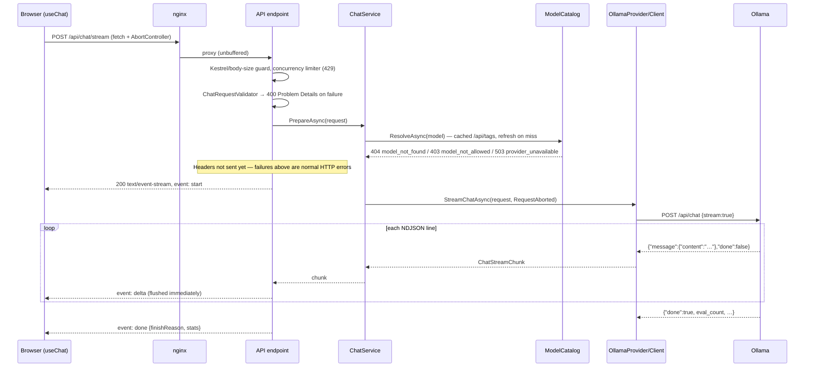

# Architecture

## Component responsibilities

| Component | Project | Owns |
|---|---|---|
| Dashboard | `src/LocalAI.Web` | Chat interaction, model selection, incremental rendering of the stream, loading/error/empty states, connection status, responsive layout. Holds conversation state in memory only. |
| Web server | `infrastructure/docker/nginx.conf` | Serves the static SPA and reverse-proxies `/api` with buffering disabled. Sets CSP and security headers. Gives the browser a single origin, so no CORS is needed. |
| HTTP API | `src/LocalAI.Api` | Endpoints, JSON contracts, validation responses, the SSE writer, Problem Details mapping, request-size and concurrency limits, configuration validation, CORS, Swagger. |
| Domain | `src/LocalAI.Core` | `IChatProvider` abstraction, chat and model records, `ChatRequestValidator`, `ModelCatalog` (discovery, caching, model policy), `ChatService` (orchestration plus metrics), `ProviderStatusService` (health without inference), `InferenceMetrics`, `InferenceException`. No ASP.NET or Ollama dependency. |
| Provider | `src/LocalAI.Providers` | The only code that knows the Ollama protocol. `OllamaClient` handles HTTP, timeouts, NDJSON parsing, and error translation; `OllamaProvider` maps wire DTOs to domain records. |
| Inference | `ollama` container | Model storage (volume `ollama-models`), loading, and generation. |

Dependency direction: `Api → Core ← Providers`, with `Api` referencing `Providers` only for DI registration (`AddOllamaProvider`). Endpoints, contracts, and React code never see Ollama's JSON format.

## Request lifecycle: `POST /api/chat/stream`



The key decision is that **all checks that can fail cheaply happen before the first byte is written**. Validation, model existence, model policy, and provider reachability all happen here, so they get proper HTTP status codes and Problem Details. Once the `200` and `start` event are sent, failures can only be reported in-band, as an `error` event.

## Streaming data flow

1. **Ollama → API.** `OllamaClient` sends with `HttpCompletionOption.ResponseHeadersRead` and reads the body through `NdjsonLineReader`. That reader:
   - buffers bytes until a `\n` arrives, so a network read may contain half a JSON object or several objects;
   - rejects any line over `MaxResponseLineBytes` (1 MiB) instead of growing memory without bound;
   - parses each line independently. A malformed line raises `provider_invalid_response`, and so does a stream that ends without `done: true`.
2. **API → browser.** `ChatStreamResult` (an `IResult`) sets `Content-Type: text/event-stream`, `Cache-Control: no-cache, no-transform`, and `X-Accel-Buffering: no`. It disables response buffering, then writes one `event:` and `data:` frame per chunk and calls `FlushAsync` after each. JSON is serialized compactly, so `data:` is always one line. Logs never go to the response body.
3. **nginx.** `proxy_buffering off`, `gzip off`, and `proxy_read_timeout 600s` for `/api/`.
4. **Browser.** `streamChat()` reads `response.body` with a `ReadableStream` reader and decodes with a streaming `TextDecoder`. `SseParser` handles arbitrary chunk boundaries, including a `\r\n` split across chunks. Each `delta` dispatches a reducer action that appends text, so the message re-renders as tokens arrive.

### Cancellation

Pressing **Stop** in the UI aborts the `fetch` through its `AbortController`. nginx then closes the upstream connection, which fires the API's `HttpContext.RequestAborted`. That token flows through `ChatService` into `OllamaClient`, which cancels the outbound `HttpClient` request, and Ollama stops generating.

Verified against a real model: the client disconnected at 2 s, and Ollama's `/api/chat` request ended at 2.0 s instead of running to 4,000 tokens.

| Cause | Detected as | Result |
|---|---|---|
| Client abort or disconnect | `OperationCanceledException` while `RequestAborted` is cancelled | Counted as `cancelled`; nothing is written; logged at Information |
| Server timeout | A linked `CancellationTokenSource` with `CancelAfter(InferenceTimeout)` fires while the caller token is **not** cancelled | Becomes `InferenceException(ProviderTimeout)`, sent as an `error` event or 504 |

The UI keeps the partial text and marks it "stopped". A stopped reply is included in later conversation history; a failed one is not.

## Provider abstraction

```csharp
public interface IChatProvider
{
    string Name { get; }
    Task<ProviderHealth> CheckHealthAsync(CancellationToken ct);           // never throws for connectivity
    Task<IReadOnlyList<ModelInfo>> ListModelsAsync(CancellationToken ct);
    IAsyncEnumerable<ChatStreamChunk> StreamChatAsync(ChatCompletionRequest request, CancellationToken ct);
}
```

Contract for implementations:

- Translate every transport and protocol failure into `InferenceException`, with a client-safe `Message` and raw upstream detail in `ProviderDetail`, which is logged only.
- Surface caller cancellation as `OperationCanceledException`, never as a timeout.
- Finish the stream with exactly one chunk where `IsFinal = true`. `ChatService` treats a stream that ends without one as a protocol error.
- Report stats (`ChatCompletionStats`) only when the backend provides them; unknown values stay `null`.

Adding llama.cpp, vLLM, or an OpenAI-compatible backend means one new class plus a registration extension. The API, Core, and React code don't change.

`ModelInfo.IsRemote` is generic: "this model runs on another host". `ModelCatalog` applies the `AllowRemoteModels` policy, so Ollama's cloud-proxied models (`remote_host` in `/api/tags`) are blocked by default and inference stays local.

## Error handling

| `InferenceErrorCode` | HTTP (pre-stream) | SSE `error.code` | Retryable | Typical cause |
|---|---|---|---|---|
| `ProviderUnavailable` | 503 | `provider_unavailable` | yes | Ollama stopped or starting; connection refused or reset |
| `ProviderTimeout` | 504 | `provider_timeout` | yes | Metadata or inference timeout |
| `ProviderInvalidResponse` | 502 | `provider_invalid_response` | no | Malformed JSON, oversized line, stream ended early |
| `ProviderError` | 502 | `provider_error` | yes | Other upstream 4xx/5xx |
| `ModelNotFound` | 404 | `model_not_found` | no | Model not installed |
| `ModelNotAllowed` | 403 | `model_not_allowed` | no | Remote model while `AllowRemoteModels=false` |
| `ModelLoadFailed` | 502 | `model_load_failed` | yes | Out of memory; the runner crashed |

Other errors:

- **Validation:** 400 `validation_failed`, with an `errors` map.
- **Malformed JSON:** 400 `invalid_request`.
- **Oversized body:** 413 `payload_too_large`.
- **Concurrency:** 429 `too_many_generations`.
- **Anything unexpected:** 500 `internal_error` with a generic message. The exception and stack trace are logged and never returned.

Mapping lives in one place, `Middleware/ErrorCatalog.cs`, shared by the Problem Details handler and the SSE writer.

**Retries.** The API never retries inference itself, because generation is expensive and not idempotent. The `retryable` flag tells the client whether a manual retry makes sense, and the UI shows a Retry button for the last failed or stopped reply.

**Logging.** The API logs the model name, message count, character count, `maxTokens`, duration, token counts, and error codes. Prompt and response text are never logged.

## Health model

Four independent signals, deliberately not collapsed into one:

| Layer | Source | Cost |
|---|---|---|
| API liveness | `GET /api/health` | No I/O |
| Provider connectivity | `GET {ollama}/api/version` | ~ms |
| Model availability | `GET {ollama}/api/tags`, filtered by the remote-model policy | ~ms |
| Inference capability | Timestamp of the last real successful generation | Free; **no synthetic inference** |

`/api/health/ready` combines the first three and returns 503 unless a usable model exists. Docker health checks use cheap probes: `/api/health` for the API, `/healthz` for nginx, and `ollama list` for Ollama.

## Key decisions

| Decision | Reasoning |
|---|---|
| SSE over WebSockets | One-way token streaming over plain HTTP: proxy-friendly, debuggable with `curl -N`, and cancelled by simply closing the request. `fetch` + `ReadableStream` is used instead of `EventSource` because the request needs a POST body. |
| Pre-stream validation and model resolution | Real HTTP status codes for the common failures; in-band errors only once streaming has begun. |
| Minimal APIs, not controllers | Small surface; `IResult` makes the SSE response a first-class, testable object. |
| Same-origin proxy | The browser never needs the API's address or CORS; `VITE_API_BASE_URL` stays empty, so no configuration is baked into the bundle. |
| Timeouts in the client, `HttpClient.Timeout = Infinite` | Lets metadata calls (10 s) and generations (5 min) have different budgets and keeps caller cancellation distinguishable from timeouts. |
| Concurrency limit rather than a queue | Local hardware serves few generations at once. Rejecting fast (429) beats unbounded queueing. |
| In-memory metrics | Honest, zero-dependency Phase 1 telemetry. Clearly labelled "since API start"; replaced by OpenTelemetry in Phase 2. |
| Block images in model output | A crafted reply could embed ``; not loading images closes that exfiltration channel. |
| Targets `net8.0` | LTS requirement. Built and tested on the official `dotnet/sdk:8.0` image. |
